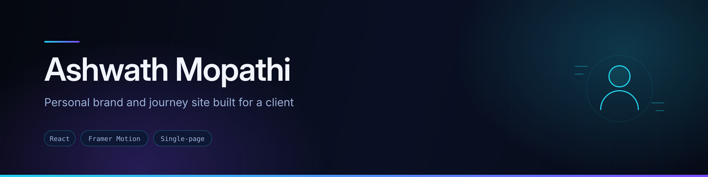
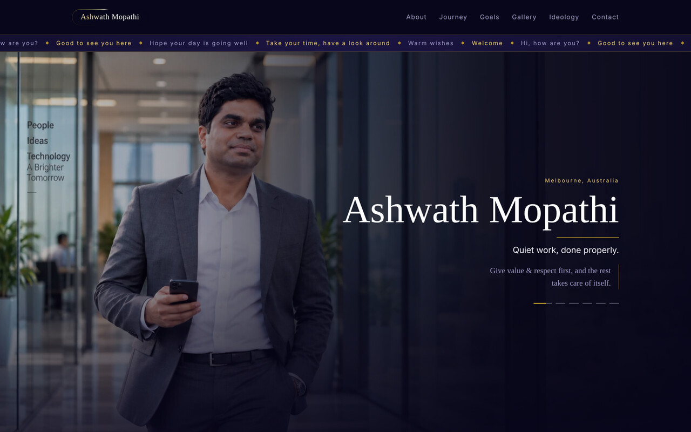

<div align="center">
  
</div>

<div align="center">


</div>

## Overview

A personal-brand website built for **Ashwath Mopathi**, Melbourne. Rather than a conventional CV page, it's a narrative single-page site: it walks a visitor through his background, the path he took from an engineering degree in India to running his own business in Australia, what he's building toward, and the principles he works by.

The editorial tone is deliberately understated — the site's own tagline is *"Quiet work, done properly."* — so the design leans on typography, generous spacing, large imagery and restrained motion rather than dense interface.

## Preview



<sub>Screenshot captured from a local production build of this repository. The photography shown is placeholder imagery — see <a href="#future-improvements">Future improvements</a>.</sub>

## Features

- **Seven narrative sections** — Hero, About, Journey, Goals, Gallery, Ideology, Contact — composed in order on one scrolling page
- **Journey timeline** rendering a year-by-year career path from a data file
- **Goals and Ideology sections** presenting the long-term plan and the working principles behind it
- **Image gallery** with motion-driven reveals
- **Direct contact** — WhatsApp and email links, plus location, rendered from the content file
- **Scroll-triggered animation** throughout, via Framer Motion
- **Single content source** — all copy lives in `src/data/content.js`, so wording can be revised without touching components
- **Responsive layout** for desktop, tablet and mobile

## Tech stack

| Layer | Technology |
|---|---|
| Framework | React (Create React App) |
| Animation | Framer Motion |
| Content | A single exported content module (`src/data/content.js`) |
| Styling | Hand-written CSS, one stylesheet per component |

## Project structure

```
src/
├── components/
│   ├── Navbar/      Section navigation
│   ├── Hero/        Opening statement
│   ├── About/       Background
│   ├── Journey/     Year-by-year timeline
│   ├── Goals/       What he's building toward
│   ├── Gallery/     Image gallery
│   ├── Ideology/    Working principles
│   └── Contact/     Contact section
├── data/
│   └── content.js   All site copy — site, nav, hero, about, journey,
│                    goals, gallery, ideology, contact, footer
├── Assets/images/   Section and gallery imagery
└── App.js           Section composition
```

## Running locally

```bash
git clone https://github.com/AJAY2043/Ashwath_Portfolio.git
cd Ashwath_Portfolio
npm install
npm start
```

The development server runs at `http://localhost:3000`.

```bash
npm run build     # production build into ./build
```

## Editing content

Every string on the page comes from `src/data/content.js`, exported as named sections:

```js
export const hero = { … };
export const journey = { items: [ { year, title, text }, … ] };
export const ideology = { … };
```

Change the copy there and the components pick it up — no component edits needed. Adding a timeline entry means adding one object to `journey.items`.

## Future improvements

- **Swap in the final photography.** The images in `src/Assets/images/` are placeholders; `content.js` flags this at the top of the file. Filenames should stay the same so no imports need changing.
- Optionally add an enquiry form alongside the existing WhatsApp and email links, delivered via EmailJS
- Add meta tags, Open Graph image and a favicon for link previews
- Remove the unused `lenis` dependency, or use it to implement the smooth scrolling it was added for
- Compress and serve imagery in modern formats for faster first paint
- Accessibility pass — reduced-motion support and heading hierarchy

## Credits

Designed and built by **Ajay Krishna Reddy Bhavanam** — Melbourne, Australia
[LinkedIn](https://linkedin.com/in/ajay-krishna-reddy) · [GitHub](https://github.com/AJAY2043)

Site content and subject: Ashwath Mopathi.
